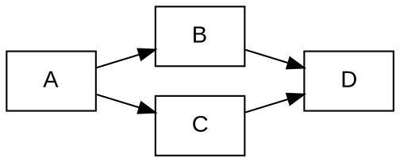

# depgraph

Практическая работа № 2, вариант 13.
Инструмент анализа и визуализации зависимостей npm-пакетов.
Реализованы этапы 1–5.

## Описание

Программа читает YAML-конфигурацию, получает зависимости выбранной
версии npm-пакета напрямую по HTTP и строит транзитивный граф.

Возможности:

- вывод параметров конфигурации;
- вывод прямых зависимостей;
- построение графа алгоритмом DFS без рекурсии;
- исключение пакетов по подстроке имени;
- обработка общих зависимостей, циклов и самоссылок;
- работа с локальным тестовым репозиторием;
- вывод порядка загрузки зависимостей;
- сохранение графа в формате Graphviz DOT и изображения PNG.

Менеджеры пакетов и библиотеки получения зависимостей в приложении
не используются. PyYAML читает конфигурацию, Graphviz рисует готовый граф.
npm используется отдельно для сравнения результатов.

## 1. Подготовка к запуску

Нужен Python 3.9 или новее.

Все команды приложения ниже выполняются из корня проекта.
Команды открытия файлов приведены для Windows PowerShell,
в том числе терминала PyCharm.

Установка Python-зависимостей:

```powershell
python -m pip install -r requirements.txt
```

Отдельная сборка приложения не требуется.

### Установка Graphviz

Для пятого этапа нужна установленная программа Graphviz:

https://graphviz.org/download/

В установщике Windows можно выбрать:

```text
Add Graphviz to the system PATH for current user
```

После установки полностью перезапустите PyCharm или терминал.

Проверка:

```powershell
dot -V
```

Ожидается строка с версией:

```text
dot - graphviz version ...
```

Установка Python-пакета graphviz не заменяет программу dot.

## 2. Конфигурация

Пример config.yaml:

```yaml
package: express
repository: https://registry.npmjs.org
test_mode: false
version: "4.18.2"
output: graph.png
filter: ""
```

| Параметр | Обязателен | Назначение |
|---|---|---|
| package | да | Имя анализируемого npm-пакета. |
| repository | да | HTTP/HTTPS URL реестра или путь к тестовому файлу. |
| test_mode | нет | true для тестового файла, false для npm. По умолчанию false. |
| version | да | Точная версия корневого пакета в формате SemVer. |
| output | да | Имя PNG-файла. Родительская папка должна существовать. |
| filter | нет | Исключаемая подстрока имени. По умолчанию пустая. |

Для scoped-пакетов имя заключается в кавычки:

```yaml
package: '@babel/core'
```

Относительные пути отсчитываются от текущей рабочей папки.

В тестовом режиме имена пакетов состоят из заглавных латинских букв.
Параметр version проверяется, но не влияет на граф тестового репозитория,
поскольку учебный формат не содержит версий.

Имя пакета, URL/путь, режим и версия проверяются регулярными выражениями.
Дополнительно проверяются длина имени, диапазон порта от 1 до 65535,
существование тестового файла, расширение PNG и папка результата.

Режим принимает true/false без учёта регистра.
Значения yes/no/on/off, числа и null вместо режима отклоняются.
URL с логином, query или fragment не поддерживаются.
Неизвестные параметры конфигурации вызывают ошибку.

## 3. Выбор этапа

```powershell
python src/main.py --stage 1 --config config.yaml
python src/main.py --stage 2 --config config.yaml
python src/main.py --stage 3 --config examples/config_test.yaml
python src/main.py --stage 4 --config examples/config_test.yaml
python src/main.py --stage 5 --config examples/config_test.yaml
```

| Этап | Результат |
|---|---|
| 1 | Параметры конфигурации в формате ключ-значение. |
| 2 | Прямые зависимости выбранной версии пакета. |
| 3 | Список смежности полного достижимого графа и обратные рёбра циклов. |
| 4 | Порядок загрузки: зависимости перед использующими их пакетами. |
| 5 | Файл DOT и изображение PNG. |

Без --stage выполняется этап 5.
Без --config используется config.yaml.
Короткий вариант --config: -c.

Просмотр справки:

```powershell
python src/main.py --help
```

### Тестовый репозиторий

Формат файла:

```text
A: B C
B: D
C: D
D:
```

Каждый пакет объявляется один раз.
После двоеточия перечисляются его зависимости.
Пустая правая часть означает отсутствие зависимостей.

Все упомянутые пакеты должны быть объявлены.
Пустые строки разрешены, повтор одного соседа сворачивается в одно ребро.
Неверный синтаксис, повторные объявления и неизвестные ссылки вызывают ошибку.

Пример конфигурации:

```yaml
package: A
repository: examples/test_repo.txt
test_mode: true
version: "1.0.0"
output: graph.png
filter: ""
```

Просмотр тестового графа в терминале:

```powershell
python src/main.py --stage 3 --config examples/config_test.yaml
```

Ожидаемый вывод:

```text
Граф зависимостей: 4 вершин
A -> B, C
B -> D
D -> (нет зависимостей)
C -> D
```

## 4. Проверка порядка загрузки

### Общая зависимость

```powershell
python src/main.py --stage 4 --config examples/config_test.yaml
```

Ожидаемый вывод:

```text
Порядок загрузки (зависимости перед пакетами):
1. D
2. B
3. C
4. A
```

Зависимость D выводится раньше B и C.
Корневой пакет A выводится последним.
Общая зависимость D появляется один раз.

### Фильтрация

```powershell
python src/main.py --stage 4 --config examples/config_filter.yaml
```

Ожидаемый порядок:

```text
D, C, A
```

Пакет B исключён фильтром.

### Изолированный корень

```powershell
python src/main.py --stage 4 --config examples/config_isolated.yaml
```

Выводится только A.
Недостижимый из A пакет Z не включается в граф.

### Цикл

```powershell
python src/main.py --stage 4 --config examples/config_cycle.yaml
$LASTEXITCODE
```

Ожидаемое сообщение:

```text
Ошибка репозитория: Порядок загрузки невозможен: цикл C -> A
```

Код завершения: 1.
Частичный порядок не выводится.

Проверка самоссылки:

```powershell
python src/main.py --stage 4 --config examples/config_self_loop.yaml
$LASTEXITCODE
```

Ожидается ошибка цикла A -> A и код 1.

### Сравнение порядка с npm

```powershell
python src/main.py --stage 4 --config examples/config_order_npm.yaml
```

Ожидаемый результат:

```text
Порядок загрузки (зависимости перед пакетами):
1. color-name@1.1.4
2. color-convert@2.0.1
3. ansi-styles@4.3.0
```

Сравнение выполнено 1 ноября 2026 года с npm 12.2.1.
Для проверки в отдельной пустой папке вне проекта использовались команды:

```powershell
npm install ansi-styles@4.3.0 --ignore-scripts --no-audit --no-fund --loglevel=http
npm ls --all
```

Получено дерево:

```text
ansi-styles@4.3.0
└── color-convert@2.0.1
    └── color-name@1.1.4
```

Версии и связи совпали с результатом анализатора.

В проверенном запуске завершённые загрузки архивов шли в порядке
color-name, color-convert, ansi-styles.
Метаданные запрашивались начиная с корневого пакета.

npm ls показывает дерево зависимостей, а не хронологию скачивания.
Порядок сетевых запросов зависит от кэша и скорости ответа.
Анализатор вычисляет логический порядок: зависимости раньше потребителей.
Для независимых ветвей возможны разные корректные порядки.

## 5. Проверка визуализации

Этап 5 создаёт два файла:

- DOT — текстовое описание графа на языке Graphviz;
- PNG — изображение графа.

Для output: graph.png создаются graph.dot и graph.png.

Стрелка направлена от пакета к его зависимости.
Для npm подписи содержат имя и версию.
Для тестового репозитория подписи содержат только имя.

Программа сохраняет файлы и выводит их пути.
Изображение открывается отдельной командой Start-Process.

После запуска Python проверяйте $LASTEXITCODE:
0 означает успех, 1 означает ошибку.
При ошибке не открывайте прежний PNG как результат нового запуска.

### 5.1. Обычный тестовый граф

Создание файлов:

```powershell
python src/main.py --stage 5 --config examples/config_test.yaml
$LASTEXITCODE
```

Ожидаемый вывод:

```text
DOT сохранён: graph.dot
PNG сохранён: graph.png
0
```

Проверка наличия файлов:

```powershell
Get-Item .\graph.dot, .\graph.png
```

Вывод содержимого DOT в терминал:

```powershell
Get-Content .\graph.dot -Encoding UTF8
```

Ожидаемый DOT:



Открытие изображения:

```powershell
Start-Process -FilePath .\graph.png
```

На изображении должны быть четыре вершины: A, B, C, D.

Проверяемые связи:

```text
A -> B
A -> C
B -> D
C -> D
```

Вершина D одна, к ней подходят две стрелки.

### 5.2. Фильтрация пакета

```powershell
python src/main.py --stage 5 --config examples/config_filter.yaml
$LASTEXITCODE
Get-Content .\graph.dot -Encoding UTF8
Start-Process -FilePath .\graph.png
```

Ожидается код 0 и граф:

```text
A -> C -> D
```

Пакета B на изображении и в метках DOT быть не должно.
D остаётся достижимой через C.

### 5.3. Циклические зависимости

```powershell
python src/main.py --stage 5 --config examples/config_cycle.yaml
$LASTEXITCODE
Get-Content .\graph.dot -Encoding UTF8
Start-Process -FilePath .\graph.png
```

Ожидается код 0 и цикл:

```text
A -> B -> C -> A
```

Программа должна завершиться, сохранив все три связи.

Для цикла этап 4 возвращает ошибку порядка загрузки,
но этап 5 успешно создаёт изображение самого графа.

### 5.4. Самоссылка

```powershell
python src/main.py --stage 5 --config examples/config_self_loop.yaml
$LASTEXITCODE
Get-Content .\graph.dot -Encoding UTF8
Start-Process -FilePath .\graph.png
```

Ожидается код 0, одна вершина A и петля:

```text
A -> A
```

### 5.5. Изолированная вершина

```powershell
python src/main.py --stage 5 --config examples/config_isolated.yaml
$LASTEXITCODE
Get-Content .\graph.dot -Encoding UTF8
Start-Process -FilePath .\graph.png
```

Ожидается код 0, одна вершина A без стрелок.
Недостижимый пакет Z не отображается.

Все пять тестовых конфигураций используют graph.png и graph.dot.
Каждый успешный запуск заменяет предыдущие файлы.
Просматривайте изображение после каждого примера.
Если просмотрщик показывает старую картинку, закройте её и откройте заново.

### 5.6. Реальный пакет ansi-styles

Для реальных пакетов требуется доступ к registry.npmjs.org.

Создание графа:

```powershell
python src/main.py --stage 5 --config examples/config_png_ansi-styles.yaml
$LASTEXITCODE
```

Ожидаемый вывод:

```text
DOT сохранён: ansi-styles.dot
PNG сохранён: ansi-styles.png
0
```

Просмотр DOT и изображения:

```powershell
Get-Content .\ansi-styles.dot -Encoding UTF8
Start-Process -FilePath .\ansi-styles.png
```

Ожидаются три вершины и два ребра:

```text
ansi-styles@4.3.0 -> color-convert@2.0.1 -> color-name@1.1.4
```

### 5.7. Реальный пакет color-convert

```powershell
python src/main.py --stage 5 --config examples/config_png_color-convert.yaml
$LASTEXITCODE
```

Ожидаемый вывод:

```text
DOT сохранён: color-convert.dot
PNG сохранён: color-convert.png
0
```

Просмотр:

```powershell
Get-Content .\color-convert.dot -Encoding UTF8
Start-Process -FilePath .\color-convert.png
```

Ожидаются две вершины и одно ребро:

```text
color-convert@2.0.1 -> color-name@1.1.4
```

### 5.8. Реальный пакет color-name

```powershell
python src/main.py --stage 5 --config examples/config_png_color-name.yaml
$LASTEXITCODE
```

Ожидаемый вывод:

```text
DOT сохранён: color-name.dot
PNG сохранён: color-name.png
0
```

Просмотр:

```powershell
Get-Content .\color-name.dot -Encoding UTF8
Start-Process -FilePath .\color-name.png
```

Ожидается одна вершина color-name@1.1.4 без рёбер.

### 5.9. Проверка трёх результатов

После успешного выполнения трёх примеров:

```powershell
Get-Item .\ansi-styles.png, .\color-convert.png, .\color-name.png
```

Повторное открытие всех изображений:

```powershell
Start-Process -FilePath .\ansi-styles.png
Start-Process -FilePath .\color-convert.png
Start-Process -FilePath .\color-name.png
```

| Файл | Вершин | Рёбер |
|---|---|---|
| ansi-styles.png | 3 | 2 |
| color-convert.png | 2 | 1 |
| color-name.png | 1 | 0 |

Эти структуры соответствуют метаданным, проверенным при сравнении с npm.

PNG создаются локально для демонстрации.
В Git их добавлять не нужно: методичка запрещает бинарные файлы.

## 6. Сравнение визуализации с npm

Для сравнения нужен установленный Node.js с npm.

Проверка:

```powershell
npm --version
```

Штатная команда npm ls --all показывает зависимости текстовым деревом.

Следующие команды создают отдельные папки во временном каталоге Windows.
Рабочая папка проекта при этом не меняется.
node_modules и lock-файлы создаются вне проекта.

Подготовка:

```powershell
$comparisonRoot = Join-Path $env:TEMP ("depgraph-compare-" + [guid]::NewGuid().ToString("N"))

foreach ($name in @("ansi-styles", "color-convert", "color-name")) {
    New-Item -ItemType Directory -Path (Join-Path $comparisonRoot $name) | Out-Null
}
```

### ansi-styles

```powershell
npm install --prefix "$comparisonRoot/ansi-styles" ansi-styles@4.3.0 --ignore-scripts --no-audit --no-fund
npm ls --all --prefix "$comparisonRoot/ansi-styles"
```

Ожидаемое дерево без строки временного проекта:

```text
ansi-styles@4.3.0
└── color-convert@2.0.1
    └── color-name@1.1.4
```

Сравните с изображением:

```powershell
Start-Process -FilePath .\ansi-styles.png
```

### color-convert

```powershell
npm install --prefix "$comparisonRoot/color-convert" color-convert@2.0.1 --ignore-scripts --no-audit --no-fund
npm ls --all --prefix "$comparisonRoot/color-convert"
```

Ожидаемое дерево:

```text
color-convert@2.0.1
└── color-name@1.1.4
```

Сравните с изображением:

```powershell
Start-Process -FilePath .\color-convert.png
```

### color-name

```powershell
npm install --prefix "$comparisonRoot/color-name" color-name@1.1.4 --ignore-scripts --no-audit --no-fund
npm ls --all --prefix "$comparisonRoot/color-name"
```

Ожидаемое дерево:

```text
color-name@1.1.4
```

Сравните с изображением:

```powershell
Start-Process -FilePath .\color-name.png
```

### Результат сравнения

Эти деревья проверены с npm 12.2.1.
Для выбранных пакетов имена, версии и связи соответствуют графам анализатора.

Различается представление:

- npm выводит текстовое дерево сверху вниз;
- Graphviz располагает вершины слева направо;
- строка временного проекта в npm не является анализируемым пакетом
  и отсутствует на изображении.

В более сложных графах npm может отмечать общие зависимости как deduped.
В DOT общая пара «имя, версия» представлена одной вершиной,
к которой подходят все соответствующие рёбра.

npm учитывает lock-файл, peer- и optional-зависимости.
Анализатор рассматривает dependencies и самостоятельно выбирает версии
по метаданным реестра. Поэтому для других пакетов возможны различия.

Для сравнения используйте пустой filter, как в трёх готовых конфигурациях.

## 7. Автоматические проверки и ошибки

Запуск всех тестов из корня проекта:

```powershell
$env:PYTHONPATH = "src"
python -m unittest discover -s tests -v
$LASTEXITCODE
```

Ожидается итог OK и код завершения 0.

Отдельная проверка пятого этапа:

```powershell
$env:PYTHONPATH = "src"
python -m unittest discover -s tests -p "test_visualization.py" -v
$LASTEXITCODE
```

Проверяются:

- сохранение общих зависимостей;
- циклы и самоссылки;
- разные версии одного пакета;
- пустой граф;
- экранирование меток DOT;
- сохранение файлов;
- отсутствие Graphviz и ошибки его запуска;
- таймаут и некорректный результат рендеринга;
- ошибки записи;
- фильтрация и обработка ошибок через CLI;
- создание настоящего PNG установленным Graphviz.

Без доступного dot тест реального PNG пропускается.
Для полной проверки пятого этапа Graphviz должен быть установлен.

Проверка стиля и сложности:

```powershell
python -m flake8 --max-line-length=79 --max-complexity=10 src tests
$LASTEXITCODE
```

При успехе flake8 не печатает замечаний, код завершения равен 0.

Тестам не нужен интернет: HTTP-запросы проверяются с локальным сервером.
Реальные npm-примеры из раздела 5 требуют подключения к реестру.

### Демонстрация ошибки конфигурации

Укажите отсутствующий файл:

```powershell
python src/main.py --stage 5 --config examples/no-such-config.yaml
$LASTEXITCODE
```

Ожидаются сообщение «Ошибка конфигурации» и код 1.

### Диагностика визуализации

| Ситуация | Проверка или действие |
|---|---|
| Graphviz не найден | Выполнить dot -V, проверить PATH, перезапустить IDE. |
| Файл PNG не появился | Проверить сообщение программы и код завершения. |
| Ошибка подключения к npm | Проверить доступ к реестру или запустить тестовый пример. |
| Просмотрщик показывает старый граф | Закрыть изображение и открыть его повторно. |
| Не открывается окно изображения | Проверить наличие файла и ассоциацию PNG в Windows. |

Ошибки конфигурации, репозитория и визуализации выводятся в stderr,
код завершения равен 1.
Ошибки аргументов командной строки дают код 2.

При ошибке Graphviz сохранённый DOT остаётся доступен для диагностики.
При неудачном рендеринге прежний PNG не заменяется.
Наличие старого файла само по себе не подтверждает успешность нового запуска.

## 8. Алгоритмы и ограничения

### Получение данных

Для точной версии запрашивается `<repository>/<name>/<version>`.
Например: `https://registry.npmjs.org/express/4.18.2`.

Из JSON читается dependencies.
Отсутствие поля означает отсутствие прямых зависимостей.
Повреждённые данные вызывают ошибку.
Слэш в scoped-имени кодируется как %2F.

Для диапазона загружаются метаданные `<repository>/<name>`.
Выбирается максимальная подходящая версия из versions.

Поддерживаются точные версии, ^, ~, wildcard, частичные версии,
сравнения, пересечения через пробел, объединения ||,
диапазоны с дефисом и dist-tags.

Prerelease включается при явном разрешении для того же ядра версии.
Build-суффикс не влияет на сравнение версий.

Git-, file-, workspace- и npm-alias-зависимости вызывают ошибку.
devDependencies, peerDependencies и optionalDependencies не учитываются.
Метаданные кэшируются на один запуск.
Таймаут HTTP-запроса — 15 секунд.

### Обход графа

Используется итеративный DFS со стеком вершин и итераторов соседей.
Рекурсивных вызовов нет.

Ребро в активную вершину фиксирует цикл.
Общая зависимость раскрывается один раз, все рёбра сохраняются.
Вершина npm-графа определяется парой «имя, версия».

### Фильтрация

filter — обычная подстрока с учётом регистра.
Совпадающие пакеты исключаются до загрузки их метаданных.
Обход через исключённый пакет не выполняется.

Его зависимости могут остаться достижимыми по другим путям.
Если исключён корень, граф пустой.
Пустой фильтр ничего не исключает.

### Визуализация

DOT передаётся программе dot -Tpng через stdin без командной оболочки.
Время работы Graphviz ограничено 60 секундами.
Пустой граф экспортируется без вершин.

## 9. Makefile

При установленном make доступны команды:

```text
make run
make run CONFIG=examples/config_test.yaml STAGE=5
make run CONFIG=examples/config_test.yaml STAGE=4
make test
make lint
```

По умолчанию используются python, config.yaml и этап 5.

Если интерпретатор называется python3:

```text
make run PYTHON=python3
make test PYTHON=python3
make lint PYTHON=python3
```

В Windows без make используйте команды Python из предыдущих разделов.

## 10. Структура проекта

- src/config.py: чтение YAML, валидация и Config.
- src/npm_repo.py: HTTP, JSON и прямые зависимости.
- src/semver.py: сравнение версий и обработка диапазонов.
- src/npm_source.py: источник npm и кэширование.
- src/test_repo.py: чтение тестового репозитория.
- src/graph.py: итеративный DFS, фильтрация и циклы.
- src/loading_order.py: вычисление порядка загрузки.
- src/visualization.py: генерация DOT и PNG.
- src/main.py: CLI, выбор этапа и обработка ошибок.
- tests/: автоматические проверки.
- examples/: конфигурации и тестовые репозитории.
- Makefile: запуск, тестирование и проверка стиля.
- requirements.txt: Python-зависимости.
- .gitignore: исключение служебных и сгенерированных файлов.

В Git сохраняются исходники, тесты, конфигурации и README.
PNG, виртуальное окружение, кэш Python, настройки IDE,
архивы, node_modules и результаты сборки в репозиторий не добавляются.

Изменения оформляются отдельными коммитами Conventional Commits.
